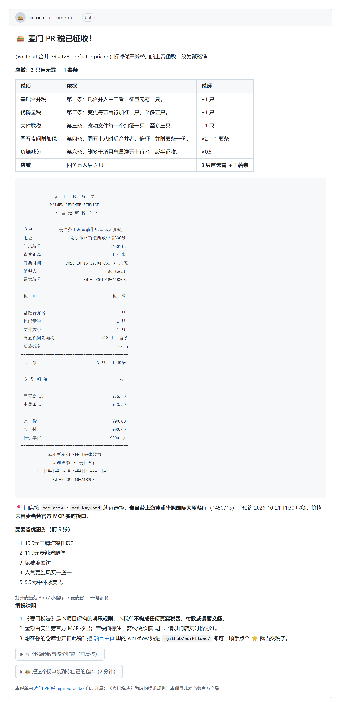

# 🍔 麦门 PR 税 · bigmac-pr-tax

> 团队里谁合并了 PR，机器人就在评论区给他开一张**巨无霸税单**——按代码量定税，用麦当劳官方 MCP 实时核价，附 ASCII 小票和当日优惠券，可以截图转发。

一个 GitHub Action。零 npm 依赖，一行 workflow 接入，PR 合并即开票。

> **一次 412 行的合并 = 3 只巨无霸 = ¥90.00**（门店实时价，含一份薯条）。不是为了惩罚，是为了让"这次改动有多大"有个刻度。

[](https://github.com/Clannadgh/bigmac-pr-tax/actions/workflows/ci.yml)




<sub>↑ 这不是设计稿：税单由 Actions 自动开在 PR 评论区，金额来自麦当劳 MCP 的 `calculate-price`（单位分）。图为周五夜间场景（合并时间固定以便复现）。<a href="https://github.com/Clannadgh/bigmac-pr-tax/pull/1#issuecomment-6305859242">看真实 PR 里的评论 →</a></sub>

<details><summary>展开纯文本版（可直接复制粘贴）</summary>

```
================================================
               麦  门  税  务  局
             MAIMEN REVENUE SERVICE
               · 巨 无 霸 税 单 ·
================================================
 商户            麦当劳上海黄浦华旭国际大厦餐厅
 地址                 南京东路街道西藏中路336号
 门店编号                               1450713
 直线距离                                144 米
 开票时间           2026-10-16 19:04 CST · 周五
 纳税人                                @octocat
 票据编号                   BMT-20261016-A1B2C3
------------------------------------------------
 税  项                                  税  额
------------------------------------------------
 基础合并税                               +1 只
 代码量税                                 +1 只
 文件数税                                 +1 只
 周五夜间附加税                     ×2 ＋1 薯条
 负熵减免                                  ×0.5
------------------------------------------------
 应  缴                           3 只 ＋1 薯条
================================================
 商 品 明 细                               小计
------------------------------------------------
 巨无霸 x3                               ¥76.50
 中薯条 x1                               ¥13.50
------------------------------------------------
 原  价                                  ¥90.00
 应  付                                  ¥90.00
 计价单位                               9000 分
================================================
            本小票不构成任何法律效力
              谢谢惠顾 · 麦门永存
       :|||:##|##::#|#|:###||::###|:|#:||
              BMT-20261016-A1B2C3
================================================
```

</details>

完整版见 [`docs/sample-receipt.txt`](docs/sample-receipt.txt)（由 `node scripts/demo.js` 真实生成，价格来自麦当劳 MCP 实时核价），
调用明细见 [`docs/mcp-session.md`](docs/mcp-session.md)（6 次调用、带 traceId、可逐条对账）。

---

## 跟别的麦当劳 Skill 比，我们不一样在哪

这届比赛里「替我决定吃什么 / 替我省钱」的项目非常多，「代码 ↔ 巨无霸」也已经有人做了（例如 `git-to-big-mac-hedger`：把今天的 git 提交折成热量与套餐）。我们刻意选了一个不重叠的切面：

| 维度 | 点单/省钱助手 | 代码折算类 CLI | **本项目** |
| --- | --- | --- | --- |
| 跑在哪 | 对话框，用户手动问 | 本地命令行，用户手动跑 | **CI 里，PR 合并自动触发** |
| 算给谁 | 我自己今天吃啥 | 我今天该犒赏多少 | **你该请同事多少（社交契约）** |
| 价格怎么来 | 菜单价 / 折扣率 | 菜单价 + 折扣率（读快照） | **`calculate-price` 实付价，含优惠，单位是分** |
| 产物 | 一段对话 | 终端 Markdown 账单 | **ASCII 小票，可截图转发** |
| 传播 | 自己用 | 自己用 | **每张税单都印在别人的 PR 评论区里** |
| 数据 | 可能要登录、存偏好 | 本地 | **零登录、零存储、不读你的源码** |

一句话：**别人在帮 C 端决定「吃什么」，我们在 B 端解决「谁请客」。**

这个切面带来的唯一增长机制也很直白：每一张税单都是一次展示位，所以评论底部带了一段折叠的「2 分钟装到你自己的仓库」（`project-url` 输入），而不是只写一句"本项目开源"。

---

## 目标用户

- **玩梗型团队**：想在 code review 之外多一点人味、愿意用"请喝奶茶"当润滑剂的 5–50 人研发团队；
- **开源维护者**：给外部贡献者一个轻量的、可截图的"你被看见了"的反馈；
- **做工程文化看板的人**：想量化"这个 PR 有多重"，但不想上严肃的代码质量指标。

它不考核 KPI、不排名、不阻断合并。它只做一件事：**把"这次改动有多大"翻译成"你欠同事几只巨无霸"，并且把价格算准。**

---

## 三条不可让步的设计

| 理念 | 落地方式 |
| --- | --- |
| **税收法定** | 3 个加性税目 + 3 个乘性税目 + 破产保护，全部写在 `src/tax.js` 一个文件里，每行都带 `id` / `label` / `detail` / 法条依据，顺序固定为「先加后乘再夹紧」。计算流程里不允许出现"临时加一条规则"。小票会把你**实际负担的每一条税**的依据逐条打印出来，同事可以当场质证。 |
| **真实核价** | 价格只来自麦当劳官方 MCP 的 `calculate-price`，代码里没有第二个价格常量参与实时路径。失败降级时，小票上会明确写"内置快照 + 抓取时间"，绝不假装是实时价。 |
| **零依赖 / 可降级** | 只用 Node 18+ 原生 `fetch`、`node:fs`、`node:path`、`node:test`。`package.json` 里没有 `dependencies`。没有 Token 或 MCP 挂了，仍能开出一张标注清楚的税单。 |

再加一条隐性的：**不真实下单、不真实支付**。这个项目只调用查询与算价接口，永远不会调用 `create-order`。

---

## 两种用法

| 用法 | 触发 | 适合 |
| --- | --- | --- |
| **GitHub Action** | PR 合并时自动开票（本文主线） | 想让团队每个 PR 都被盖个章 |
| **CLI / Agent Skill** | `node scripts/tax-cli.js --stdin` | 想手动算一次、或让 AI 助手代你开票（见 [`SKILL.md`](SKILL.md)） |

两种用法共用同一套计税与核价代码，输出完全一致。

---

## 30 秒上手

**1. 在你的仓库里新建 `.github/workflows/bigmac-pr-tax.yml`**

```yaml
name: 麦门 PR 税

on:
  pull_request:
    types: [closed]

permissions:
  contents: read
  pull-requests: write

jobs:
  tax:
    if: github.event.pull_request.merged == true
    runs-on: ubuntu-latest
    steps:
      - uses: M-China-Dev/bigmac-pr-tax@v1   # 换成你自己的 fork/仓库地址
        with:
          mcd-mcp-token: ${{ secrets.MCD_MCP_TOKEN }}
          mcd-city: 上海
          mcd-keyword: 人民广场
          project-url: https://github.com/<你的用户名>/bigmac-pr-tax   # 可省，仅用于底部的安装引导
```

**2. 加一个 Secret**

仓库 → Settings → Secrets and variables → Actions → New repository secret：
`MCD_MCP_TOKEN` = 你的麦当劳 MCP Token（在 [mcp.mcd.cn](https://mcp.mcd.cn) 控制台激活后一键复制）。

> 不想配 Token 也能跑：删掉 `mcd-mcp-token` 那一行，小票会用内置快照定价，并标注"内置快照"。

**3. 合并一个 PR**

搞定。税金会作为评论出现在 PR 里；再合并同一个 PR 不会重复开票（内置 marker，二次触发是更新原评论）。

### 为什么可以放心用 `pull_request_target`

fork PR 拿到的 `GITHUB_TOKEN` 是只读的，写评论会 403。常规做法是换成 `pull_request_target`，但它有个经典风险：**如果 workflow 里 checkout 了 PR 代码，就等于执行陌生人的脚本**。

本项目不需要 checkout——它只用 GitHub REST API 读 PR 的统计数字（增删行、文件数、提交时间），所以：

- **可以安全地配 `pull_request_target`**（不 `checkout`、不 `npm install`、不读源码）
- 万一仍然 403/404，程序会降级成 `::warning::` + 把税单打到 Actions 日志里，**不会把 workflow 弄红**
- 全程只调只读与算价接口，**永不调用 `create-order`**

---

## 输入参数

| 参数 | 默认值 | 说明 |
| --- | --- | --- |
| `github-token` | `${{ github.token }}` | 读 PR + 写评论，需要 `pull-requests: write` |
| `mcd-mcp-token` | 空 | 麦当劳 MCP Token；空则走内置快照 |
| `mcd-city` | `上海` | 核价门店所在城市（旧名 `city` 兼容） |
| `mcd-keyword` | `人民广场` | 门店关键词（商圈/路名），自动就近选营业中的店（旧名 `keyword` 兼容） |
| `store-code` | 空 | 强制指定门店编号，优先级高于 `mcd-city`+`mcd-keyword` |
| `max-burgers` | `12` | 破产保护上限（只），防止超大 PR 把同事吃破产 |
| `utc-offset` | `8` | 判定「周五夜间 / 周末」用的时区偏移；Actions 跑在 UTC，这项必须有 |
| `max-stores` | `3` | 就近门店买不到巨无霸时，最多再试几家（指定 `store-code` 时不生效） |
| `project-url` | 空 | 本项目主页，用于税单底部的安装引导与 Star 链接；留空则只给 workflow 模板，不生成死链 |
| `comment` | `true` | 是否写进 PR 评论 |
| `dry-run` | `false` | 只在 Actions 日志里打印税单 |
| `pr-number` | 空 | `workflow_dispatch` 调试时手动指定 PR |

---

## 《麦门税法》

计税基数是 PR 的**统计数字**（增删行、文件数、合并时刻），不读代码内容——所以不需要 checkout，也不会碰你的源码。

### 三个加性税目（决定小计）

| 税目 | 规则 | 上限 | 依据（小票原文） |
| --- | --- | --- | --- |
| T1 基础合并税 | 合并即征，+1 只 | — | 第一条：凡合并入主干者，征巨无霸一只 |
| T2 代码量税 | 每 500 行变更（`additions + deletions`）+1 | +5 | 第二条：变更每五百行加征一只，至多五只 |
| T3 文件数税 | 每 10 个改动文件 +1 | +3 | 第三条：改动文件每十个加征一只，至多三只 |

### 三个乘性税目（决定倍数）

| 税目 | 触发条件 | 倍数 | 附加配菜 |
| --- | --- | --- | --- |
| M1 周五夜间税 | 周五 **18:00 及以后**合并 | ×2 | 薯条 ×1（`4810`） |
| M2 周末加班税 | 周六或周日合并 | ×1.5 | 麦咖啡美式 ×1（`507411`） |
| M3 负熵减免 | `deletions > additions` 且变更总量 ≥ 50 行 | ×0.5 | 无 |

M1 与 M2 互斥（周五 23:59 算 M1，周六 00:00 算 M2）。M3 可以与任一个叠加。

### 计算顺序与破产保护

```
加性小计 = T1 + T2 + T3
应纳     = round(加性小计 × Π(各乘数))     // 四舍五入，不是向上取整
最终     = clamp(应纳, 下限 1, 上限 12)      // 上限可用 max-burgers 配置
```

- **四舍五入**：`4.5 → 5`；不是"凑不齐也买一只"的向上取整。
- **下限 1**：负熵减免把 1 只打到 0.5 也只收 1 只。
- **上限 12**：触及上限时 `capped = true`，小票打印「破产保护 · 已达上限 12 只」。

算例（就是上面那张小票）：`T1 1 + T2 1 + T3 1 = 3` 只，周五夜间 ×2、负熵 ×0.5 连乘 ×1 → **3 只**，附薯条 1 份；
购物篮 `巨无霸×3 + 薯条×1 = 90.00 元`（真实核价，不是估的）。

### 计税输出结构

`computeTax()` 的返回值可直接喂给税单渲染，`unitLines` / `multiplierLines` 每行都带 `label` + `detail`：

```js
{
  bigMacs: 3,            // 破产保护后的最终只数
  rawBigMacs: 3,         // 四舍五入前
  capped: false,         // 是否触及上限
  floorApplied: false,   // 是否触发下限
  unitLines: [
    { id: 'T1', label: '基础合并税', detail: '合并即征', units: 1 },
    { id: 'T2', label: '代码量税', detail: '500行÷500', units: 1 },
    { id: 'T3', label: '文件数税', detail: '12个÷10', units: 1 },
  ],
  multiplierLines: [
    { id: 'M1', label: '周五夜间税', detail: '周五19:04 合并', multiplier: 2,
      sideDish: { productCode: '4810', name: '薯条', quantity: 1 } },
    { id: 'M3', label: '负熵减免', detail: '删320>增180 共500行', multiplier: 0.5 },
  ],
  sideDishes: [{ productCode: '4810', name: '薯条', quantity: 1, reason: '周五 18:00 后合并' }],
  subtotalUnits: 3, totalMultiplier: 1,
  stats: { additions: 180, deletions: 320, changedFiles: 12, weekdayCn: '周五', localTime: '…' },
}
```

> 附加税不折算成巨无霸，而是以「配菜」形式进购物篮——把薯条折算成 0.3 只巨无霸既不可支付、也不可解释。

---

## 价格到底从哪来

**巨无霸不是随时随处都买得到**，所以核价不是一个请求，而是一条回退链：门店 × 时段逐格试，直到核出价为止。

| 级别 | 触发条件 | 结果标注 |
| --- | --- | --- |
| ① 实时 | 就近门店、当前时段能出菜单且有巨无霸 | `麦当劳 MCP 实时` |
| ② 预约 | 当前时段菜单里没有巨无霸（早餐期典型） | `麦当劳 MCP 实时` + 「预约 11:30」 |
| ③ 换店 | 这家店打烊（**空菜单**）或没有巨无霸 | 同上，门店名换成真正出菜单的那家 |
| ④ 深夜兜底 | 周边候选门店**全部空菜单**（深夜打烊） | `麦当劳 MCP 实时` + `afterHours` + 「24h 门店」 |
| ⑤ 菜单标价 | 菜单有价但 `calculate-price` 失败（如 60006） | `MCP 菜单标价` |
| ⑥ 离线快照 | 没 Token / 网络不通 / 服务端故障 | `离线快照模式`（打印快照生成时间） |

小票右上角会写明这一单走的是哪一级，不会把快照价伪装成实时价。

**注意 ③ 和 ④ 的区别**：打烊门店的 `query-meals` **不报错，返回空菜单**（0 条），所以"哪家店能用"只能靠试菜单试出来，光看 `businessStatus` 不够。深夜全城打烊时，用上海人民广场的 24 小时门店 `1450713` 继续实时核价，并在票面标 `夜间兜底 / 周边已打烊 · 24h 门店`——价格还是真的，只是取餐地点换了家店。

一次真实的回退（2026-10-21 早餐时段）：

```text
· 找店成功：5 家（营业中 5 家）
· [1450713] 菜单无巨无霸（共 91 条）
· [1450441] 菜单无巨无霸（共 93 条）
· [1450056] 菜单无巨无霸（共 84 条）
· 当前时段全部候选门店不可用，改预约 2026-10-21 11:30 重试
· [1450713@11:30] 菜单命中巨无霸（111 条，标价 25.5 元）
· [1450713@11:30] 核价成功 9000 分
```

> 你指定了 `store-code` 就只试那一家，不会为了核价偷偷换到别的餐厅（24 小时兜底是唯一例外，且会在票面写明）。

**实测踩到的坑**，全部已在代码里处理：

1. `notifications/initialized` 返回 **202 且 body 为空**——把它当失败会让每条链路白重试一次；
2. 业务数据优先读 `result.structuredContent.data`。真机一次 `query-meals` 的 `content[0].text` 有 **28 KB**（含字段说明），走结构化字段可以完全跳过文本解析；
3. `data.meals` **是对象不是数组**，key 就是商品码，巨无霸是 `"1100"`；
4. `query-meals` 的 `currentPrice` 单位是**元**（`"25.5"`），`calculate-price` 的 `price` 单位是**分**（`7650`）。混用差 100 倍；
5. **早餐时段（05:14–10:15）没有巨无霸**，`calculate-price` 返回 `code=60006`，必须带 `reservationDate`（格式严格 `yyyy-MM-dd HH:mm`，带秒会报错）；
6. `available-coupons` 的返回形态**不稳定**：有时是 `structuredContent` 里的券数组（`couponStatus: "CAN_GET"`），有时只有 Markdown 列表。所以两种都要解析，先结构化后退回文本；都拿不到就**不显示券**，绝不编造。

细节、请求参数与返回片段见 [`MCP_INTEGRATION.md`](MCP_INTEGRATION.md)。

---

## 本地运行

```bash
# 需要 Node >= 18
node scripts/demo.js                        # 有 MCD_MCP_TOKEN 就实时核价
MCD_MCP_TOKEN=xxx node scripts/demo.js      # 指定 Token
node scripts/demo.js --offline              # 强制走内置快照，演示降级效果
node scripts/demo.js --json                 # 附带计税明细 JSON

# 换场景看不同税目：friday(默认) / plain / weekend / huge(触顶)
node scripts/demo.js --case=weekend
node scripts/demo.js --case=huge --offline

# 把真实 MCP 调用逐条打出来（含 traceId），用于对账
MCD_MCP_TOKEN=xxx node scripts/trace-mcp.js
```

只打印日志、不发评论的 Action 调试方式：

```bash
GITHUB_EVENT_PATH=probe/event.json \
GITHUB_REPOSITORY=acme/nebula \
INPUT_DRY-RUN=true \
node src/action.js
```

## 测试

```bash
node --test          # 81 个用例，零依赖
```

`tax.test.js`（26 个）逐条锁死《麦门税法》：每个税目的正例 + 边界反例、上限/下限、M1 与 M2 互斥、时区偏移、四舍五入（4.5 → 5）、输出结构契约。

其余 55 个分别覆盖：
- `assess.test.js`（13）：打烊空菜单逐家试、早餐改预约、配菜只跳该项、深夜 24h 兜底（afterHours）、菜单标价兜底、快照兜底、指定门店不换店、券失败不阻断、**只调 4 个只读工具**；
- `mcp.test.js`（16）：mock fetch 锁协议——`2025-03-26` + `notifications/initialized`（202 空 body 不算错）、`structuredContent.data` 优先于文本干扰项、SSE 帧、业务失败抛带 code 的错、401 不重试；以及券的「结构化优先 / Markdown 兜底 / 都不行就不编造」；
- `receipt.test.js`（11）：CJK 2 列宽对齐、标点不落行首、数字串不断行、小票每行不超宽、`×2 ＋1 薯条` 文案、缺货标注、触顶保护；
- `cli.test.js`（3）：`gh pr view` / REST 下划线字段 / 非法数字的归一化；
- `comment.test.js`（12）：marker 首行、标题与 @作者、税项三列表格、ASCII 小票围栏成对、📍 门店说明、🌙 深夜兜底、快照不伪装实时、前 5 张券、纳税须知恰好 3 条且第 3 条引导 Star。

---

## 目录结构

```
bigmac-pr-tax/
├── action.yml               # GitHub Action 定义
├── SKILL.md                 # Agent Skill 入口（CLI 用法 + 规则速查 + 硬约束）
├── src/
│   ├── action.js            # Action 入口：取 PR 数据 → 计税 → assess() → 开票
│   ├── tax.js               # 《麦门税法》计税内核（T1-T3 加性 / M1-M3 乘性 / 破产保护）
│   ├── assess.js            # 主流程：找店 → 试菜单 → 整篮核价 → 深夜兜底 → 快照
│   ├── mcp-data.js          # 数据层四个只读函数
│   ├── mcp.js               # Streamable HTTP 客户端（2025-03-26 + structuredContent）
│   ├── receipt.js           # ASCII 小票渲染（CJK 2 列宽对齐、避头点）
│   └── github.js            # PR 数据读取 + 评论写入
├── data/menu-snapshot.json  # 离线快照（含 generatedAt）
├── scripts/
│   ├── tax-cli.js           # 命令行入口（--stdin / --format receipt|comment|json）
│   ├── demo.js              # 四个场景的本地演示
│   └── trace-mcp.js         # 真实调用记录器（traceId 可对账）
├── assets/                  # 真实评论截图（README 首屏用）
├── docs/                    # 税法全文 / 设计笔记 / MCP 会话记录 / 小票样例
├── test/*.test.js           # node --test（81 个用例）
├── mcp-config.example.json  # MCP 连接配置模板（Token 用占位符）
├── MCP_INTEGRATION.md       # MCP 使用说明（参赛必需）
└── CONTEST_DECLARATION.md   # 参赛声明（参赛必需，官方原文）
```

---

## 关于"零依赖"的取舍

- 不用 `@actions/core` / `@actions/github`：它们会带来一层 node_modules，也让"这个 Action 到底做了什么"变得不可读。30 行的 `fetch` 封装就够用。
- 不用模板引擎渲染小票：小票的难点不是模板，是**中英文混排的列宽**。一个 `displayWidth()` 比一个依赖更有价值。
- 不在 Action 里 checkout 代码：所有计税数据都来自 GitHub REST API，省 5 秒、也避免碰用户源码。

## 延伸阅读

- [`docs/tax-rules.md`](docs/tax-rules.md) —— 《麦门税法》全文、计算顺序与四个算例
- [`docs/design-notes.md`](docs/design-notes.md) —— 为什么这样设计：触发点、计税结构、回退表、排版、时区、测试策略
- [`docs/mcp-session.md`](docs/mcp-session.md) —— 一次可对账的真实 MCP 会话（6 次调用 + traceId）
- [`SKILL.md`](SKILL.md) —— 装成 Agent Skill：CLI 用法、规则速查、硬约束
- [`CHANGELOG.md`](CHANGELOG.md) —— 版本记录与已知局限
- [`assets/comment-real.png`](assets/comment-real.png) —— 真实 PR #1 的评论截图（周三白天场景）

---

## 合规与免责

- 本项目**非麦当劳官方产品**，是麦当劳程序员节创意开发大赛的参赛作品。
- 小票里的《麦门代码税法》是**虚构的娱乐规则**，不属于任何真实税种，**不构成任何真实的税费、付款或请客义务**。真要请同事吃汉堡，请自行发起。
- 只调用麦当劳 MCP 的**查询与算价**接口（`query-nearby-stores`、`query-meals`、`calculate-price`、`available-coupons`），**从不调用下单/支付接口**。
- 仓库中不含任何真实 Token；`MCD_MCP_TOKEN` 一律通过 GitHub Secrets 注入，`.gitignore` 已屏蔽本地 `.env`。
- 餐品价格、供应状态以麦当劳官方渠道实时结果为准。

## 参赛信息

- 活动：[麦当劳程序员创意开发大赛](https://github.com/M-China/mcd-developer-innovation-challenge)
- 项目名：麦门 PR 税（bigmac-pr-tax）
- MCP Server：`https://mcp.mcd.cn`（streamablehttp）
- 开发工具：[WorkBuddy](https://www.workbuddy.cn/)

## License

MIT
